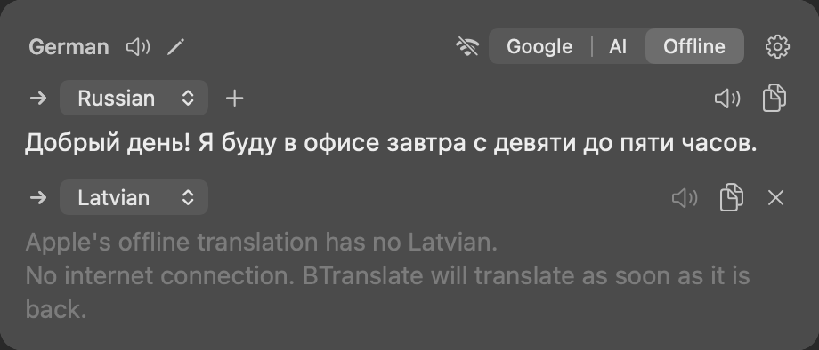
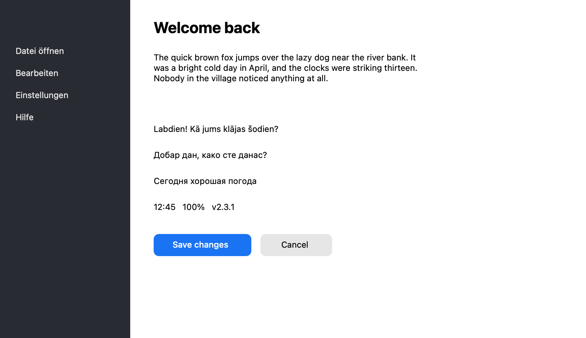
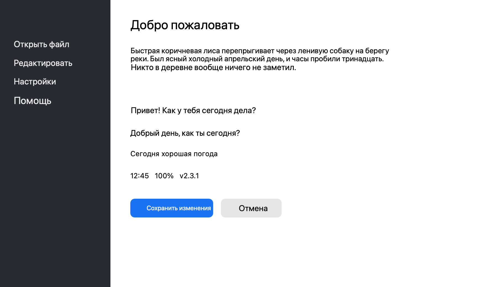
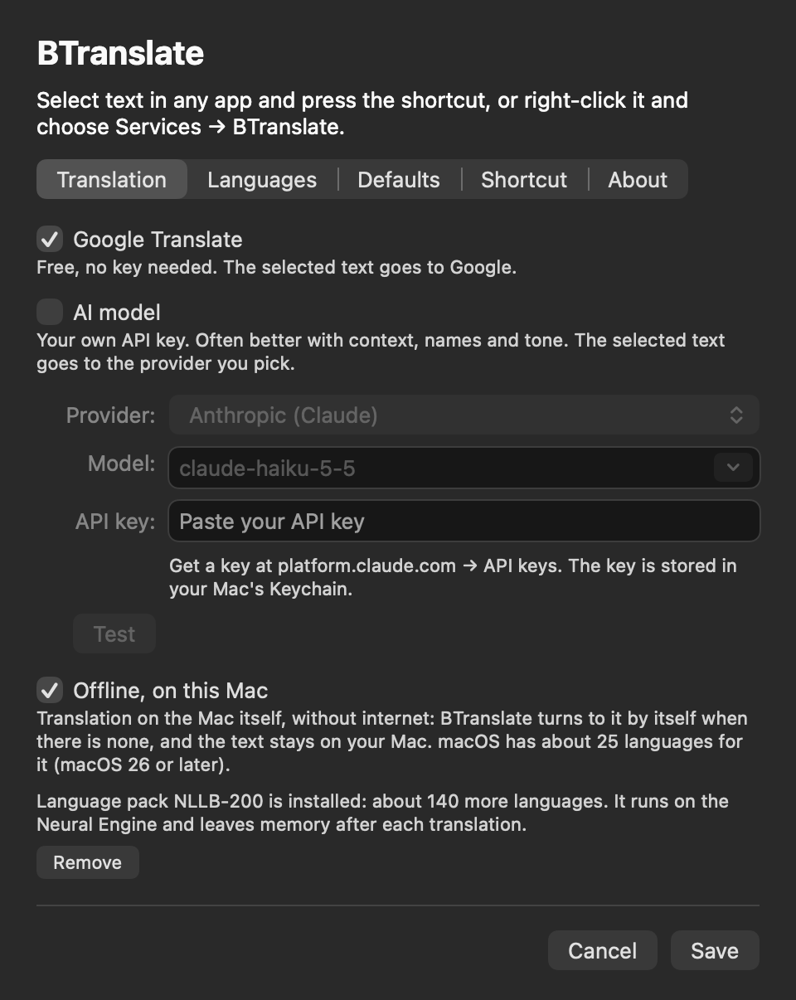
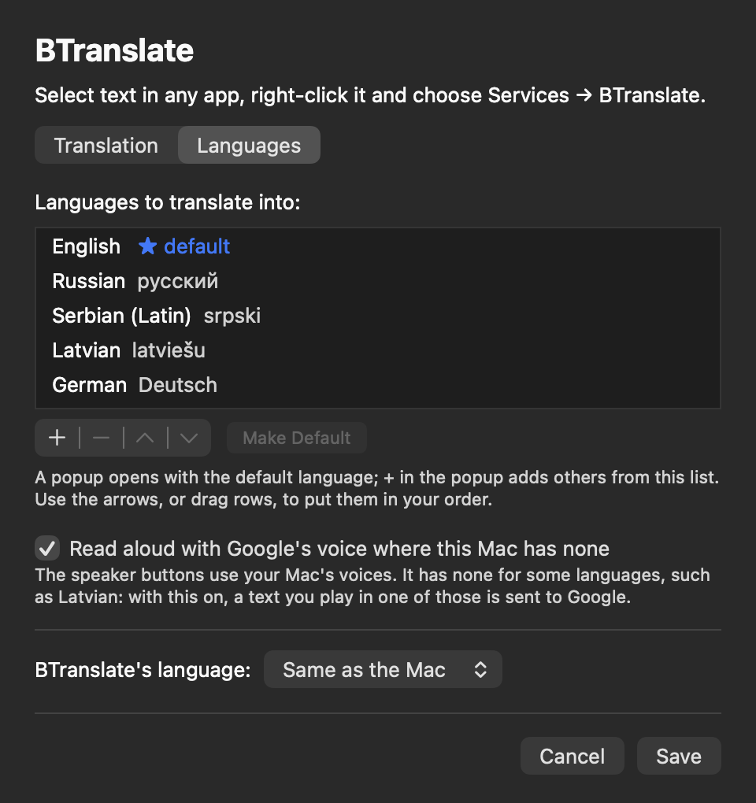
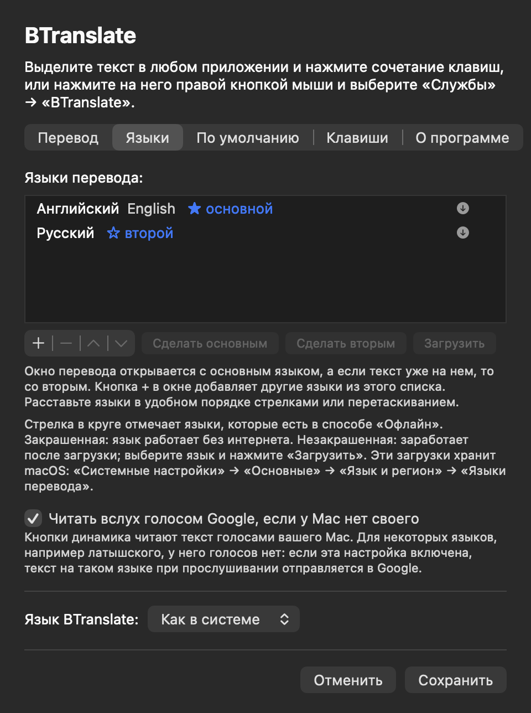
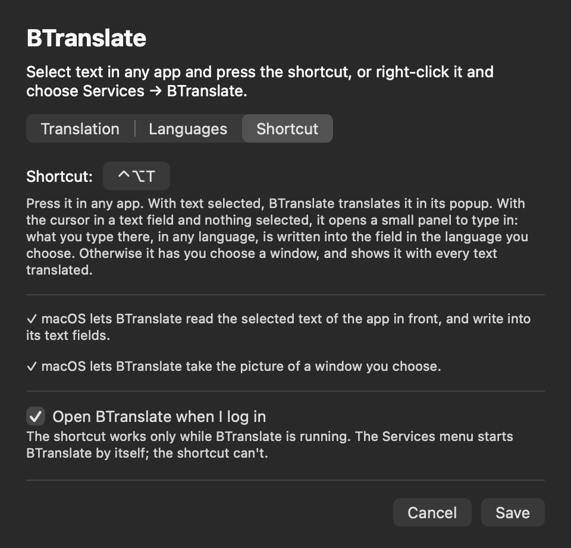

# BTranslate

Translate selected text in **any Mac app** with a shortcut or from the right-click menu. The
translation shows in a small popup next to the text, and the app you are in stays in front.
The same shortcut lets you **type in another language** straight into any text field, and
shows a **whole window translated**. It uses
**Google Translate** (free, no key) or an **AI model** with your own API key (Claude, GPT,
Gemini, DeepSeek, OpenRouter or a local server), so it also covers languages Apple's built-in
translator doesn't have, such as Latvian and Serbian. Without internet it translates on the
Mac itself: with that built-in translator, and with an optional language pack that runs on
the Neural Engine for the languages Apple lacks.

[](https://github.com/baakhoff/btranslate/actions/workflows/ci.yml)
[](https://github.com/baakhoff/btranslate/releases)
[](LICENSE)


## What you get

- **One shortcut, ⌃⌥T (yours to change), that does what fits where you are:**
  - **Text is selected:** its translation, in the popup.
  - **The cursor is in a text field, nothing selected:** a small panel opens under the cursor. What you type there, in any language, is written into the field in the language you set for it, while you type. Return keeps it, Esc takes it out again.
  - **Neither:** you choose a window, and get it back as a picture with every text in one language, whatever languages it was in.
- **A right-click menu item** for the first of those: select text, right-click it and choose **Services → BTranslate**. It needs no permission at all.
- **A popup, not another app:** the translation appears by the pointer. Esc, ⌘W or a click anywhere else closes it. Drag it if it's in the way.
- **Three ways to translate, one click apart:**
  - **Google Translate:** free and instant, no account.
  - **An AI model:** often better with context, names and tone. The answer streams in as it is written.
  - **Offline:** on the Mac itself. It needs no internet and the text stays on your Mac. macOS has about 25 languages for it; the optional **language pack** adds about 140 more, Latvian and Serbian among them.
  - You choose which one a popup opens with; the others are a click away in the popup. The AI model shows there only once it has its API key.
- **It copes without internet:**
  - The popup goes over to the Offline method by itself, and a crossed-out Wi-Fi sign shows why.
  - A language the Offline method has not got says so and waits: it is translated as soon as the connection is back.
  - Where the language pack would do it, a button in the popup downloads the pack (at once, or as soon as there is a connection), and the popup translates when it is there.
  - With the Offline method turned off, or on a Mac without it, the whole popup waits the same way.
- **Several languages at once:** **+** next to the language adds another one from your list. Each gets its own translation, speaker and copy button; **×** takes it out again.
- **A second default language:** a text that is in your default language already is translated into the second one instead (Russian text into English, say), without a click.
- **The source language is detected** and shown. If the guess is wrong, click the **pencil** next to it and pick the right language (there's a search): the popup translates again.
- **Listen:** one speaker button reads the original aloud, another the translation.
  - Your Mac's own voices do it, offline. The Croatian voice also reads Serbian and Bosnian.
  - macOS has no voice for some languages (Latvian, for one). For those, Google Translate's voice can read the text; you can turn that off in the setup window.
  - Google's voice needs internet. Without it, a note under the speaker button says that the text can't be read aloud now, and why.
- **Your own list of languages:**
  - Add any of the 249 languages Google Translate knows, as many or as few as you like.
  - Serbian comes in both Latin and Cyrillic script, and a Serbian text can be turned from one alphabet into the other.
  - Put them in your order and choose the default one: a popup opens with it.
  - The list starts with your Mac's own languages.
- **Copy:** the copy button or ⌘C copies a translation (or the part you selected).
- **In English and in Russian:** BTranslate's own windows, messages and language names follow your Mac's language, or the one you pick in the setup window. The installer does too.
- **Small:** one native app of under 2 MB, no Dock icon, no menu bar icon. What reads a window's picture runs in a process of its own and is gone when it is done.



A window in four languages, and the same window after the shortcut (here into Russian). The
line that was in Russian already, and the numbers, are left as they were:





## The language pack

An optional download for the Offline method: **NLLB-200** ("No Language Left Behind") by
Meta AI, converted for Apple's Neural Engine.

- **What it adds:** it has 166 of Google's languages, about 140 of which macOS can't translate offline: Latvian, Lithuanian, Estonian, Serbian, Croatian and Bosnian among them. Where macOS has both languages, its own translation is used.
- **How to get it:** the installer asks about it; later, setup window → Translation → **Download** under "Offline, on this Mac" (906 MB), or the button the popup shows when a translation needs it. The download can be stopped and goes on from where it was; every file is checked against its checksum. **Remove** takes it off the Mac again.


- **Where it runs:** on the Neural Engine, never on the GPU. Of the model's 840 operations, 825 run there; a vocabulary lookup and the search for the best words run on the CPU. That is on a Mac with Apple silicon. An Intel Mac has no Neural Engine: there Core ML has only the CPU left (not tested).
- **Memory:** the model is loaded for a translation and let go right after it. Loading takes a tenth of a second.
- **Speed:** about a second per sentence on an M5 Pro. The translation shows sentence by sentence.
- **Quality:** good for understanding a text; below an AI model. It gets names of institutions wrong at times, and writes less well into the small languages than out of them.
- **It has to know the language of the text:** told a wrong one it writes nonsense. So the pack brings its own detector, Meta's language-identification model for the same languages, made small (20 MB of the download).
  - It is a table of letter groups, read on the CPU in a tenth of a millisecond: nothing here for the Neural Engine, and nothing stays in memory.
  - Over the pack's languages it tells 97 of 100 sentences right. The Mac's own recognizer knows 53 languages and tells 35 of 100 (Persian is Arabic to it, Tajik is Bulgarian).
  - A word or two is harder: about half of single words are told right, 80 of 100 in the big languages. There the Mac's recognizer and your own languages (your list, and what you picked with the pencil lately) have a say too.
  - When BTranslate is not sure, it asks for the pencil and says what the text may be; the pencil's list starts with those languages.
- **Licence:** the model is [CC-BY-NC 4.0](https://creativecommons.org/licenses/by-nc/4.0/): non-commercial use only. BTranslate's own code is MIT; the pack is not part of this repository, only the recipe for making it ([tools/nllb](tools/nllb/README.md)).

## Requirements

- macOS 14 or later, Apple silicon or Intel.
- The Command Line Tools, for the Swift compiler the installer builds the app with: `xcode-select --install`.
- For the Offline method with macOS's own languages: macOS 26 or later, and the Command Line Tools of that macOS. The language pack is made for macOS 14 and later (tested on macOS 27).

## Install

```bash
curl -fsSL https://raw.githubusercontent.com/baakhoff/btranslate/main/install.sh | bash
```

It downloads the release, builds it on your Mac (a few seconds), puts
`BTranslate.app` in `~/Applications` and opens the setup window. Nothing needs `sudo`.

On a Mac with Apple silicon the installer then asks whether to download the
[language pack](#the-language-pack) (906 MB): BTranslate needs it to work properly without
internet. Enter says yes; `BTRANSLATE_PACK=yes` or `no` in front of `bash` answers beforehand.

From a checkout, run `./install.sh`.

### Setup



The setup window has three pages.

**Translation** asks:

1. **Which methods to use:** Google Translate, an AI model, the Offline method, or any of them together.
2. **For the AI model:** the provider, the model and your API key.
   - The model menu fills with the provider's own list once the key is in.
   - **Test** sends one short sentence, so you know the key and model work before you save.
3. **Which method BTranslate opens with**, when more than one can be used. The AI model is on offer here, and in the popup, once it has a key (or, for a server of your own, its address).

**Languages** asks:

1. **Which languages to translate into:**
   - **+** opens a searchable list (by English name or the language's own name); click the ones you want. **−** removes the selected ones.
   - The arrows move the selected language up or down; you can also drag rows.
   - **Make Default** marks the language a popup opens with. In the popup, **+** adds any of the others.
   - **Make Second** marks the second default: the one a popup opens with when the text is in the default language already. Until you choose one, it is the first other language of the list.
   - An arrow in a circle marks a language the Offline method has. Filled: it works without internet. Empty: it does after a download, which **Download** starts: of that language by macOS (which asks you to confirm), or of the language pack.
2. **Which language to write into text fields in:** the one the typing panel opens with. Until you choose, it is the second default.
3. **Whether Google's voice may read aloud** the languages your Mac has no voice for.
4. **BTranslate's own language:** the same as the Mac, English or Russian. BTranslate restarts itself in the background to switch; nothing else changes.



The same page in Russian. A language is found by its Russian name, its English name or its own:




**Shortcut** asks:

1. **Which shortcut:** click the field and press the keys. ⌫ takes the shortcut away.
2. **For your permission,** once: the shortcut reads what is selected in the app in front, and writes into its text fields, through macOS's Accessibility. **Open System Settings…** takes you to the switch. The page also says whether macOS lets BTranslate take a window's picture, which it asks about the first time you choose a window.
3. **Whether BTranslate opens when you log in.** The shortcut works only while BTranslate runs, so this is ticked when you first set BTranslate up; macOS tells you when the login item is added.



To change any of it later, open BTranslate from Spotlight or Finder, or click the gear in
the popup.

### The shortcut

**⌃⌥T** unless you choose another. It is a key by its place on the keyboard, so it is the
same key in the Russian layout.

- **What it needs:** your permission under System Settings → Privacy & Security → Accessibility, and BTranslate running (tick **Open BTranslate when I log in**). Until the permission is there, the shortcut opens the Shortcut page instead. Translating a window needs a second permission in the same place, **Screen & System Audio Recording**: macOS asks for it the first time you choose a window, and that first window is not translated; press the shortcut again once it is given.
- **After an update the permissions have to be given again:** take BTranslate off those lists with **–** and add it again. macOS ties the permission to the exact build of an app that has no developer signature, and the installer builds a new one each time.
- **Unless this Mac signs BTranslate itself:** from a checkout, `tools/local-signing.sh` makes a signing certificate named "BTranslate (this Mac)" in your login keychain, and the installer signs with it from then on. Every build is then the same app to macOS, and the permission stays. macOS asks for your password when the certificate's key is first used. Whoever can use that certificate can make a program macOS takes for BTranslate, so it is a choice, not the default; `tools/local-signing.sh --remove` takes it out again.
- **Typing in another language:**
  - The panel opens with the language set on the Languages page (**Write into text fields in**); its own menu picks another for that time. The method is the one BTranslate opens with.
  - A finished sentence is translated once and stays as it is; only the one you are typing changes.
  - With a keyboard layout that is one language's own (Russian, Ukrainian, Greek…) the text is taken for that language. With Latin letters the translator finds out itself.
  - **Written while you type:** in a Mac's own text fields (Notes, Mail, Messages…), and on web pages in one-line fields and in boxes that are empty when you start.
  - **Pasted when you press Return:** in a web page's box that has text in it already. Such a box can't be told from a formatted editor, and writing into one flattens what it holds; pasting does not. The panel shows the translation meanwhile, and the clipboard is put back as it was. The same goes for any app that does not take the text.
  - The web pages were checked with Safari's engine. Apps built on Chromium or Electron are treated by the same rules, which was not checked in such an app.
  - Password fields are left alone.
- **A window, translated:**
  - You choose the window in macOS's own picker, the one screen sharing uses. BTranslate takes a picture of that one window, at that moment, and of nothing else at any other time.
  - The picture's texts are read on your Mac; only the texts go to the translation method, never the picture.
  - macOS reads print in about 30 languages well. Others in Latin or Cyrillic letters (Latvian, Serbian) come out right for the most part; handwriting and tiny print may not.
  - The very first reading can take a minute: macOS makes its reader of pictures ready for the app, once. BTranslate has that done when it starts, so it is mostly over before you need it; if not, the window says so.
  - The language menu under the picture translates it into another language; **Original** shows it as it was; **Copy** or ⌘C copies the picture.
- **Where an app hides its text fields** (some browsers built on Chromium do, until an assistive app asks), the shortcut can't tell that the cursor is in one, and offers the window instead. Apps built with Electron show them when asked, which BTranslate does: the first press in such an app may take a second. Selected text still works there: it is taken with the app's own Copy command, and your clipboard is put back.
- **Pressed again** while its popup, panel or picker is showing, the shortcut puts it away.

The right-click menu item can have a shortcut of its own, from macOS: System Settings →
Keyboard → Keyboard Shortcuts… → Services → Text → **BTranslate**. If the menu item is
missing in an app that was already open during the install, restart that app.

## AI providers

| Provider | Default model | Where the key comes from |
|---|---|---|
| Anthropic (Claude) | `claude-haiku-5-5` | platform.claude.com |
| OpenAI | `gpt-6-luna` | platform.openai.com |
| Google Gemini | `gemini-3.8-flash` | aistudio.google.com |
| DeepSeek | `deepseek-chat` | platform.deepseek.com |
| OpenRouter | `anthropic/claude-haiku-5.5` | openrouter.ai/keys |
| Custom (OpenAI-compatible) | you type it | Ollama, LM Studio, oMLX…: any server with `/chat/completions` |

A small, fast model is the right choice here: a translation of a paragraph costs a small
fraction of a cent. You can type any other model name the provider offers.

## Privacy

- **The text you translate** goes to the method you use for that popup: Google, or the AI provider you picked. With the Offline method it goes nowhere: macOS translates it on your Mac. Nothing else leaves your Mac, and BTranslate has no server, account or analytics of its own.
- **The shortcut** looks at the app in front only at the moment you press it: at what is selected, and at whether the cursor is in a text field. Nothing is watched in between, and no key you press elsewhere is seen.
- **What you type in the panel** goes to the method BTranslate opens with, sentence by sentence, as any text you translate does.
- **A window's picture** is taken only of the window you choose, when you choose it, and stays on your Mac. macOS reads its texts there, and only those texts go to the translation method. The permission macOS wants for it is the one to record the screen; BTranslate uses it for nothing else.
- **A log of the shortcut,** `~/Library/Logs/BTranslate.log`, says which of its three things it did in which app, to find a fault by. It never holds a text: only its length.
- **Reading aloud** uses your Mac's voices and sends nothing anywhere. Only when you press a speaker button for a language your Mac has no voice for, and Google's voice is turned on in the setup window, is that text sent to Google.
- **The language pack** is downloaded from this project's releases on GitHub, and nothing is sent when it translates.
- **Your API key** is stored in your Mac's login Keychain and is sent only to its provider.
- **Google Translate** is reached through the public endpoints Google's own pages and Chrome use. They are not an official API:
  - Google may limit how fast one address can ask. BTranslate then switches to the second endpoint by itself, and tells you if both refuse.
  - For heavy use, an AI model with your own key is the dependable choice.

## Update and uninstall

Run the install line again to update: your settings and key are kept.

To remove the app, its menu item, its settings, its language pack and its saved keys:

```bash
curl -fsSL https://raw.githubusercontent.com/baakhoff/btranslate/main/uninstall.sh | bash
```

Add `-s -- --keep-keys` after `bash` to leave the API keys in the Keychain.

## Build and test

```bash
./build.sh        # build/BTranslate.app for this Mac (--universal: Apple silicon + Intel)
tests/run.sh      # no network or key needed; --live also uses the real Google, Keychain and
                  # preferences; --screen also shows a popup for three seconds and checks
                  # focus and typing
```

There is no Xcode project and there are no dependencies: `swiftc` compiles the files in
`Sources/`.

- **`tests/run.sh`:**
  - runs the app's own checks (`BTranslate --selftest`), in English and in Russian;
  - checks that every text of the app has its Russian translation (`tools/check-strings.py`);
  - translates through `tests/mock_server.py`, which stands in for Anthropic, the OpenAI-style providers and Google;
  - draws the popup, the settings window and the language pickers off screen, into `build/uitest/` and, in Russian, `build/uitest-ru/`, and checks that no label or button is cut short;
  - downloads a miniature language pack from the mock server: checksums, a damaged file, a download that goes on from where it stopped;
  - reads a made-up detector file of a few rows and compares every answer with the Python that wrote it;
  - makes popups off screen (`BTranslate --popup-check`) and checks what they turn to: the second default, the methods on offer with and without an API key, the offer of the language pack and its download;
  - runs the installer's question about the language pack, with each answer;
  - takes the connection away (Google's address stops answering) and checks that the popup goes over to the Offline method, waits where it must, and translates when the connection is back. A stand-in answers for Apple's translation, so this runs on any Mac;
  - makes speech with a Mac voice without playing it;
  - checks the shortcut as the settings keep it, and its page of the setup window, where a click and three keys record one;
  - types into the panel off screen, with a stand-in for the other app's text field: one that takes every writing, one that takes none, one that stops;
  - draws a picture that stands for a window, has macOS read it, translates it through the mock server and checks which lines were put together, what was left alone, and the window that shows the result.
- **The app's command line,** for trying things: `BTranslate --print --engine google --from lv --to Russian "Labdien"` prints a translation, and `BTranslate --speech-check lv "Labdien"` says which voice would read a text and plays it at volume zero, and `BTranslate --detect "Labdien"` shows what the language pack's detector, the Mac's recognizer and both together take a text for. `Sources/main.swift` lists the rest.
- **The icon:** `swift tools/make-icon.swift` draws `Resources/AppIcon.icns`.
- **The language list:** `python3 tools/update-languages.py` rewrites `Sources/Languages.swift` from Google's own list, in English and in Russian (one request each), for when Google adds languages.
- **Another language for BTranslate itself:**
  - The texts are in English in the source, as `L("Save")`. A translation is one file, `Resources/<code>.lproj/Localizable.strings`, with the English text as the key: copy `Resources/ru.lproj` and translate it.
  - Add the language to `interfaceLanguages` in `Sources/Localization.swift`, to `CFBundleLocalizations` in `Resources/Info.plist` and to `LOCALIZATIONS` in `tools/update-languages.py`, then run that tool for Google's names of the languages.
  - `python3 tools/check-strings.py` says which texts are missing, left over, or lost a `%@`.

## How it works

- **The menu item** is a macOS Service the app declares in its `Info.plist`. macOS hands it the selected text; no accessibility or screen permission is involved.
- **The shortcut** is a hot key macOS itself listens for and tells the app about; that part needs no permission either.
  - What is selected, and whether the cursor is in a text field, the app asks of the app in front through the Accessibility interface, with half a second's patience. Where an app does not say what is selected, its own Copy command is chosen in its menu (never a key press), and the clipboard is put back.
  - **Typing** writes into the field through the same interface, in one of two ways, and reads the field back to see that it arrived. A Mac's own field has the text before selected and replaced, from the first letter that differs. A web page's field says yes to that and does nothing, so there the field's whole text is set anew, with the cursor put back behind what was written. `BTranslate --ax-check` does all this against a window of its own: a Mac text view, and a web page's `<input>`, `<textarea>` and editable `<div>`, empty and not.
  - **A window's picture** comes from `SCContentSharingPicker`, the picker of ScreenCaptureKit, and `SCScreenshotManager`. (The picker alone is not enough for macOS: on macOS 27 the picture is refused until the app may record the screen.) Vision reads the lines, in a process of its own that the app starts for each picture; lines of a paragraph are put together (a full line of several words, with the next right under it), while the rows of a list stay apart. All texts go to Google in one request, each from its own language; an AI model gets them as numbered lines. Each translation is painted over its original in letters of the same size (judged by the line's width, which macOS gives exactly) and colour, on the colour that was behind it.
- **The popup** is a panel that does not activate its app, so your app keeps the front. The app stays running in the background after its first use, so later popups open at once.
- **The Offline method** is Apple's Translation framework, which translates on the Mac, and the language pack for what Apple lacks.
  - Apple has about 25 languages, and not Latvian, Serbian or Croatian: those need the language pack (or an AI model of your own on the Mac: the Custom provider with Ollama, LM Studio or oMLX runs without internet too).
  - The pack's model is two Core ML programs, an encoder and a decoder, with 8-bit weights. The app has its own tokenizer for it (checked against Meta's on 60 texts) and searches for the translation with a beam of four. [tools/nllb](tools/nllb/README.md) says how the model is made and what the conversion had to get around.
  - Some Macs have all of Apple's languages ready: on the one BTranslate was written on (macOS 27) none needed a download. On others each language is a download; macOS keeps them under System Settings → General → Language & Region → Translation Languages.
  - Offline, the Mac itself has to tell what language a text is in, and on a short text it is less sure than Google. When it can't tell, the popup says so: set the language with the pencil.
  - "No connection" is what a failed request says, not a guess made beforehand. A local AI server that does not answer is reported as that, not as missing internet.
  - `BTranslate --offline` says whether a Mac has the method and which languages.
- **BTranslate's own language** is chosen the way macOS chooses it for any app: the first of your languages that the app comes in.
  - The choice in the setup window is stored as the app's own `AppleLanguages` preference, which is also what System Settings → Language & Region → Applications sets. An app's language is fixed when it starts, so BTranslate then starts itself anew in the background.
  - An AI model is told the languages in English whatever BTranslate's language is.
- **Serbian in two alphabets:** Google writes Serbian in Cyrillic only, and hands a Serbian text back unchanged. So BTranslate changes the alphabet itself, in both directions.
  - Going to Cyrillic, it leaves in Latin what looks foreign: words with q, w, x or y, abbreviations such as STL, names like GitHub, and English in brackets or with a hyphen ("open-source").
  - A foreign name that nothing marks as foreign is converted letter by letter. The AI method does better with those.
- **The app is signed ad hoc** (no Apple developer account), which is why the installer builds it on your Mac instead of downloading a binary that Gatekeeper would block. Set `BTRANSLATE_SIGN_IDENTITY` to sign with an identity of your own, or have `tools/local-signing.sh` make one for this Mac.
- **API keys** are read and written through `/usr/bin/security`, so an update (a new ad hoc signature) does not bring up a Keychain prompt.

## License

[MIT](LICENSE)
