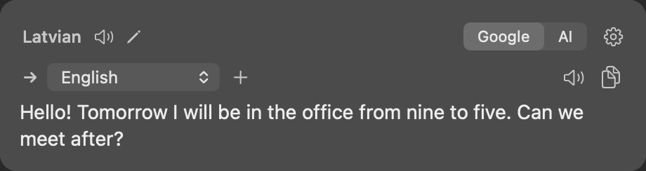
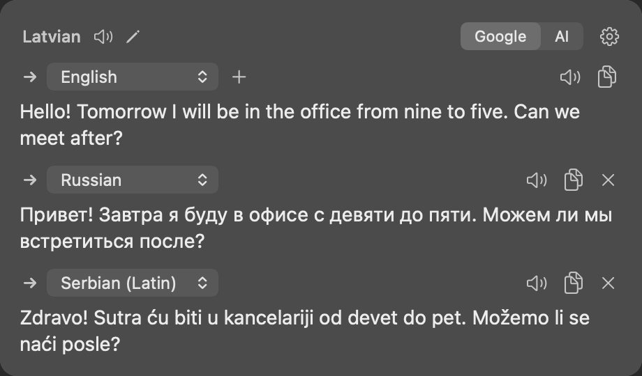
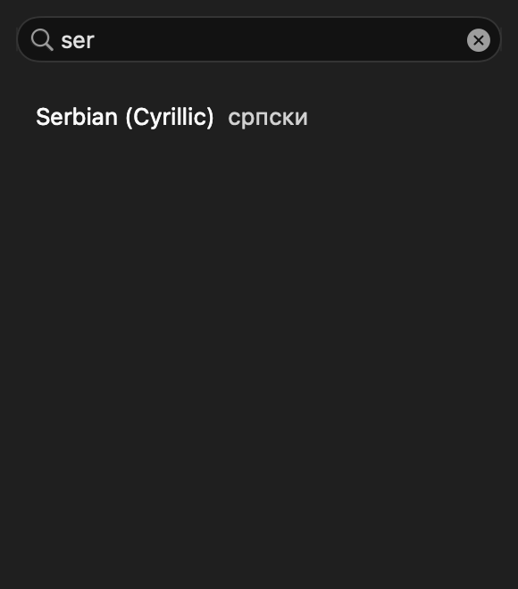

# BTranslate

Translate selected text in **any Mac app** from the right-click menu. The translation shows in
a small popup next to the mouse pointer, and the app you are in stays in front. It uses
**Google Translate** (free, no key) or an **AI model** with your own API key (Claude, GPT,
Gemini, DeepSeek, OpenRouter or a local server), so it also covers languages Apple's built-in
translator doesn't have, such as Latvian and Serbian.

[](https://github.com/baakhoff/btranslate/actions/workflows/ci.yml)
[](https://github.com/baakhoff/btranslate/releases)
[](LICENSE)





## What you get

- **A right-click menu item:** select text, right-click it and choose **Services → BTranslate**. You can also give it a keyboard shortcut.
- **A popup, not another app:** the translation appears by the pointer. Esc, ⌘W or a click anywhere else closes it. Drag it if it's in the way.
- **Two ways to translate, one click apart:**
  - **Google Translate:** free and instant, no account.
  - **An AI model:** often better with context, names and tone. The answer streams in as it is written.
  - You choose which one a popup opens with; the other is a click away in the popup.
- **Several languages at once:** **+** next to the language adds another one from your list. Each gets its own translation, speaker and copy button; **×** takes it out again.
- **The source language is detected** and shown. If the guess is wrong, click the **pencil** next to it and pick the right language (there's a search): the popup translates again.
- **Listen:** one speaker button reads the original aloud, another the translation.
  - Your Mac's own voices do it, offline. The Croatian voice also reads Serbian and Bosnian.
  - macOS has no voice for some languages (Latvian, for one). For those, Google Translate's voice can read the text; you can turn that off in the setup window.
- **Your own list of languages:**
  - Add any of the 249 languages Google Translate knows, as many or as few as you like. Serbian comes in both Latin and Cyrillic script.
  - Put them in your order and choose the default one: a popup opens with it.
  - The list starts with your Mac's own languages.
- **Copy:** the copy button or ⌘C copies a translation (or the part you selected).
- **Small:** one native app of under 1 MB, no Dock icon, no menu bar icon, under 30 MB of memory while it waits.

## Requirements

- macOS 14 or later, Apple silicon or Intel.
- The Command Line Tools, for the Swift compiler the installer builds the app with: `xcode-select --install`.

## Install

```bash
curl -fsSL https://raw.githubusercontent.com/baakhoff/btranslate/main/install.sh | bash
```

It downloads the release, builds it on your Mac (a few seconds), puts
`BTranslate.app` in `~/Applications` and opens the setup window. Nothing needs `sudo`.

From a checkout, run `./install.sh`.

### Setup


The setup window has two pages.

**Translation** asks:

1. **Which methods to use:** Google Translate, an AI model, or both.
2. **For the AI model:** the provider, the model and your API key.
   - The model menu fills with the provider's own list once the key is in.
   - **Test** sends one short sentence, so you know the key and model work before you save.
3. **Which method BTranslate opens with**, when both are on.

**Languages** asks:

1. **Which languages to translate into:**
   - **+** opens a searchable list (by English name or the language's own name); click the ones you want. **−** removes the selected ones.
   - The arrows move the selected language up or down; you can also drag rows.
   - **Make Default** marks the language a popup opens with. In the popup, **+** adds any of the others.
2. **Whether Google's voice may read aloud** the languages your Mac has no voice for.




To change any of it later, open BTranslate from Spotlight or Finder, or click the gear in
the popup.

### Keyboard shortcut

System Settings → Keyboard → Keyboard Shortcuts… → Services → Text → **BTranslate**.

If the menu item is missing in an app that was already open during the install, restart
that app.

## AI providers

| Provider | Default model | Where the key comes from |
|---|---|---|
| Anthropic (Claude) | `claude-haiku-5-5` | platform.claude.com |
| OpenAI | `gpt-6-luna` | platform.openai.com |
| Google Gemini | `gemini-3.8-flash` | aistudio.google.com |
| DeepSeek | `deepseek-chat` | platform.deepseek.com |
| OpenRouter | `anthropic/claude-haiku-5.5` | openrouter.ai/keys |
| Custom (OpenAI-compatible) | you type it | Ollama, LM Studio, oMLX…: any server with `/chat/completions` |

A small, fast model is the right choice here: a translation of a paragraph costs a small
fraction of a cent. You can type any other model name the provider offers.

## Privacy

- **The text you translate** goes to the method you use for that popup: Google, or the AI provider you picked. Nothing else leaves your Mac, and BTranslate has no server, account or analytics of its own.
- **Reading aloud** uses your Mac's voices and sends nothing anywhere. Only when you press a speaker button for a language your Mac has no voice for, and Google's voice is turned on in the setup window, is that text sent to Google.
- **Your API key** is stored in your Mac's login Keychain and is sent only to its provider.
- **Google Translate** is reached through the public endpoints Google's own pages and Chrome use. They are not an official API:
  - Google may limit how fast one address can ask. BTranslate then switches to the second endpoint by itself, and tells you if both refuse.
  - For heavy use, an AI model with your own key is the dependable choice.

## Update and uninstall

Run the install line again to update: your settings and key are kept.

To remove the app, its menu item, its settings and its saved keys:

```bash
curl -fsSL https://raw.githubusercontent.com/baakhoff/btranslate/main/uninstall.sh | bash
```

Add `-s -- --keep-keys` after `bash` to leave the API keys in the Keychain.

## Build and test

```bash
./build.sh        # build/BTranslate.app for this Mac (--universal: Apple silicon + Intel)
tests/run.sh      # no network or key needed; --live also uses the real Google and Keychain;
                  # --screen also shows a popup for three seconds and checks focus and typing
```

There is no Xcode project and there are no dependencies: `swiftc` compiles the files in
`Sources/`.

- **`tests/run.sh`:**
  - runs the app's own checks (`BTranslate --selftest`);
  - translates through `tests/mock_server.py`, which stands in for Anthropic, the OpenAI-style providers and Google;
  - draws the popup, the settings window and the language pickers off screen, into `build/uitest/`;
  - makes speech with a Mac voice without playing it.
- **The app's command line,** for trying things: `BTranslate --print --engine google --from lv --to Russian "Labdien"` prints a translation, and `BTranslate --speech-check lv "Labdien"` says which voice would read a text and plays it at volume zero. `Sources/main.swift` lists the rest.
- **The icon:** `swift tools/make-icon.swift` draws `Resources/AppIcon.icns`.
- **The language list:** `python3 tools/update-languages.py` rewrites `Sources/Languages.swift` from Google's own list (one request), for when Google adds languages.

## How it works

- **The menu item** is a macOS Service the app declares in its `Info.plist`. macOS hands it the selected text; no accessibility or screen permission is involved.
- **The popup** is a panel that does not activate its app, so your app keeps the front. The app stays running in the background after its first use, so later popups open at once.
- **The app is signed ad hoc** (no Apple developer account), which is why the installer builds it on your Mac instead of downloading a binary that Gatekeeper would block. Set `BTRANSLATE_SIGN_IDENTITY` to sign with an identity of your own.
- **API keys** are read and written through `/usr/bin/security`, so an update (a new ad hoc signature) does not bring up a Keychain prompt.

## License

[MIT](LICENSE)
