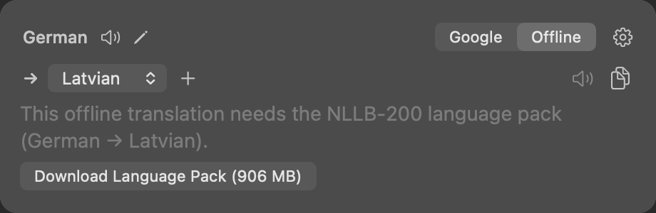
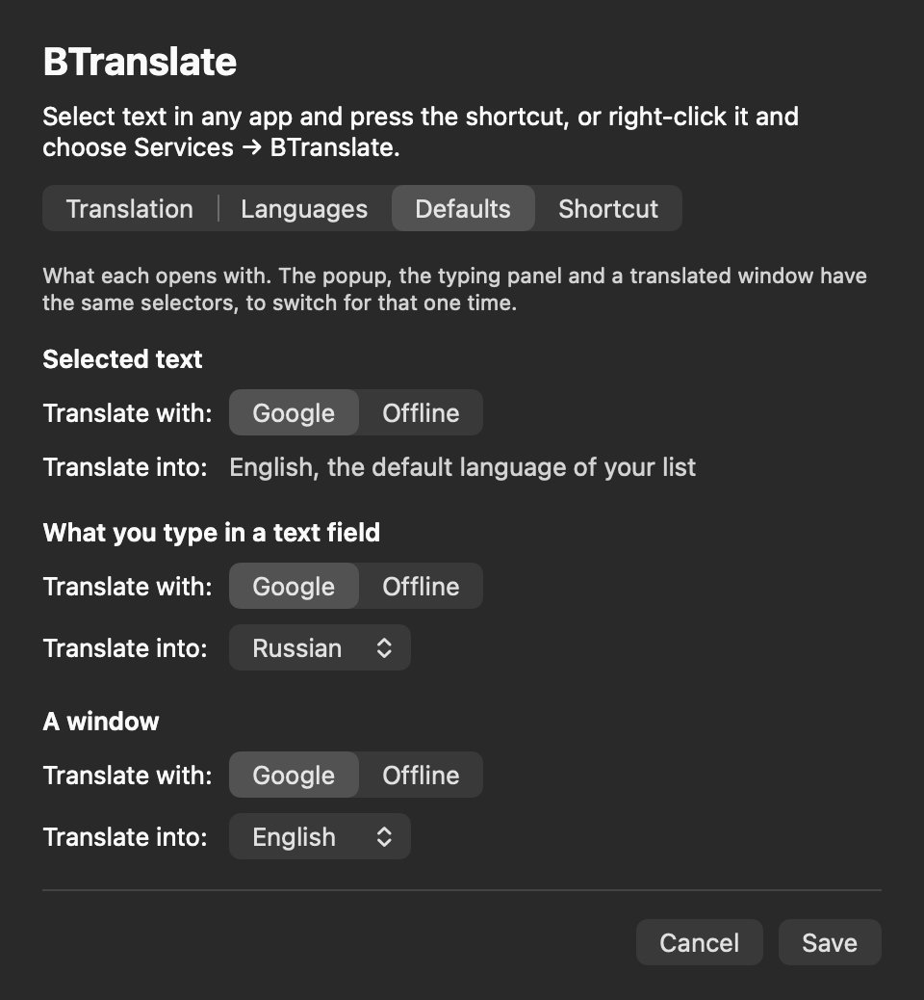

# BTranslate

Translate in **any Mac app** without leaving it. Select text and press a shortcut, or use the
right-click menu: the translation shows in a small popup right there, and the app you are in
stays in front. The same shortcut lets you **type in another language** straight into any
text field, and shows a **whole window translated**.

It translates with **Google Translate** (free, no key), with an **AI model** and your own API
key (Claude, GPT, Gemini, DeepSeek, OpenRouter or a local server), or **offline** on the Mac
itself. So it also covers the languages Apple's built-in translator doesn't have, such as
Latvian and Serbian.

[](https://github.com/baakhoff/btranslate/actions/workflows/ci.yml)
[](https://github.com/baakhoff/btranslate/releases/latest)
[](LICENSE)


## Install

```bash
curl -fsSL https://raw.githubusercontent.com/baakhoff/btranslate/main/install.sh | bash
```

- **What it does:** downloads the release, builds it on your Mac (a few seconds) and puts `BTranslate.app` in `~/Applications`. Nothing needs `sudo`.
- **What it needs:** macOS 14 or later, Apple silicon or Intel, and the Command Line Tools for the Swift compiler: `xcode-select --install`.
  - The build is checked with the tools of macOS 15 and macOS 26, down to version 16.0 (Swift 6.0). If yours are older and the build fails, update them in Software Update.
  - macOS's own offline languages need macOS 26 and its tools. After an upgrade to macOS 26, run the install line again.
- **The language pack:** on a Mac with Apple silicon the installer asks whether to download [it](#the-language-pack) (906 MB), which BTranslate needs to work properly without internet. Enter says yes; `BTRANSLATE_PACK=yes` or `no` in front of `bash` answers beforehand.
- **Then** BTranslate's settings window opens: see [Settings](#settings).
- **To update,** run the same line again: your settings and key are kept.
- **From a checkout:** `./install.sh`.

## What you get

- **One shortcut, ⌃⌥T (yours to change), that does what fits where you are:**
  - **Text is selected:** its translation, in the popup.
  - **The cursor is in a text field, nothing selected:** a small panel opens under the cursor. What you type there, in any language, is written into the field in the language you set for it, while you type.
  - **Neither:** you choose a window, and get it back as a picture with every text in one language, whatever languages it was in.
- **A right-click menu item** for the first of those: select text, right-click it and choose **Services → BTranslate**. It needs no permission at all.
- **A popup, not another app:** Esc, ⌘W or a click anywhere else closes it. Drag it if it's in the way.
- **Three ways to translate, one click apart:**
  - **Google Translate:** free and instant, no account.
  - **An AI model:** often better with context, names and tone. The answer streams in as it is written. It shows in the popup once it has its API key.
  - **Offline:** on the Mac itself. It needs no internet and the text stays on your Mac. macOS has about 25 languages for it; the optional **language pack** adds about 140 more, Latvian and Serbian among them.
- **Each use with its own defaults:** selected text, what you type and a window each open with the method and the language you set for them, and each has the selectors to switch on the spot.
- **Several languages at once:** **+** next to the language adds another one from your list. Each gets its own translation, speaker and copy button.
- **A second default language:** a text that is in your default language already is translated into the second one instead (Russian text into English, say), without a click.
- **The source language is detected** and shown. If the guess is wrong, click the **pencil** next to it and pick the right language: the popup translates again.
- **Listen:** one speaker button reads the original aloud, another the translation.
  - Your Mac's own voices do it, offline. The Croatian voice also reads Serbian and Bosnian.
  - macOS has no voice for some languages (Latvian, for one). For those, Google Translate's voice can read the text; you can turn that off in the settings.
- **Your own list of languages:** any of the 249 languages Google Translate knows, in your order. Serbian comes in both Latin and Cyrillic script, and a Serbian text can be turned from one alphabet into the other.
- **In English and in Russian:** BTranslate's own windows, messages and language names follow your Mac's language, or the one you pick in the settings.
- **Small:** one native app of about 2 MB, no Dock icon, no menu bar icon.


### Without internet

- The popup goes over to the Offline method by itself, and a crossed-out Wi-Fi sign shows why.
- A language the Offline method has not got says so and waits: it is translated as soon as the connection is back.
- Where the language pack would do it, a button in the popup downloads the pack (at once, or as soon as there is a connection), and the popup translates when it is there.
- With the Offline method turned off, or on a Mac without it, the whole popup waits the same way.
- Reading aloud with Google's voice needs internet. Without it, a note under the speaker button says that the text can't be read aloud now, and why.

Here Russian comes from macOS's own translation and Latvian from the language pack:


## The shortcut

**⌃⌥T** unless you choose another. It is a key by its place on the keyboard, so it is the
same key in the Russian layout. Pressed again while its popup, panel or picker is showing, it
puts it away.

- **What it needs:**
  - **Your permission** under System Settings → Privacy & Security → **Accessibility**. Until it is there, the shortcut opens the Shortcut page of the settings instead, which takes you to the switch.
  - **A second permission** for translating a window, in the same place: **Screen & System Audio Recording**. macOS asks for it the first time you choose a window, and that first window is not translated; press the shortcut again once it is given.
  - **BTranslate running:** tick **Open BTranslate when I log in** on the Shortcut page. Quitting BTranslate (⌘Q in its settings window) stops the shortcut until you open it again.
- **After an update the permissions have to be given again:** take BTranslate off those lists with **–** and add it again. macOS ties a permission to the exact build of an app that has no developer signature, and the installer builds a new one each time.
- **Unless this Mac signs BTranslate itself:** from a checkout, `tools/local-signing.sh` makes a signing certificate named "BTranslate (this Mac)" in your login keychain, and the installer signs with it from then on. Every build is then the same app to macOS, and the permissions stay.
  - macOS asks for your password when the certificate's key is first used.
  - Whoever can use that certificate can make a program macOS takes for BTranslate, so it is a choice, not the default. `tools/local-signing.sh --remove` takes it out again.

### Typing in another language

- The panel opens with the language and the method set for it on the Defaults page of the settings. Its own menu and selector pick another for that time: what is typed is then translated anew. The gear opens the settings.
- **Return** keeps what was written. **Esc** takes it out again. A click elsewhere ends the panel: what is written in the field stays, and nothing is pasted.
- A finished sentence is translated once and stays as it is; only the one you are typing changes.
- With a keyboard layout that is one language's own (Russian, Ukrainian, Greek…) the text is taken for that language. With Latin letters the translator finds out itself.
- **Written while you type:** in a Mac's own text fields (Notes, Mail, Messages…), and on web pages in one-line fields and in boxes that are empty when you start.
- **Pasted when you press Return:** in a web page's box that has text in it already. Such a box can't be told from a formatted editor, and writing into one flattens what it holds; pasting does not. The panel shows the translation meanwhile, and the clipboard is put back as it was. The same goes for any app that does not take the text.
- The web pages were checked with Safari's engine. Apps built on Chromium or Electron are treated by the same rules, which was not checked in such an app.
- Password fields are left alone.

### A window, translated

A window in four languages, and the same window after the shortcut (here into Russian). The
line that was in Russian already, and the numbers, are left as they were:


- You choose the window in macOS's own picker, the one screen sharing uses. BTranslate takes a picture of that one window, at that moment, and of nothing else at any other time.
- The picture's texts are read on your Mac; only the texts go to the translation method, never the picture.
- macOS reads print in about 30 languages well. Others in Latin or Cyrillic letters (Latvian, Serbian) come out right for the most part; handwriting and tiny print may not.
- A window is read in under half a second. Its texts then go to Google or to an AI provider several requests at a time; offline, macOS takes about a fifth of a second over each text.
- macOS makes its reader of pictures ready for an app once, and again after each update of itself, which takes about a minute. BTranslate has that done in the background when it is installed and when it starts, so it is over before you need it; if not, the window says so.
- It opens with the language and the method set for windows on the Defaults page of the settings. Under the picture, the language menu and the method selector translate it anew, without reading it again.
- **Original** shows the window as it was; **Copy** or ⌘C copies the picture; the gear opens the settings.

### Where the shortcut can't see

- **Some browsers built on Chromium hide their text fields** until an assistive app asks. There the shortcut can't tell that the cursor is in one, and offers the window instead.
- **Apps built with Electron** show them when asked, which BTranslate does: the first press in such an app may take a second.
- **Selected text still works** in both: it is taken with the app's own Copy command, and your clipboard is put back.

The right-click menu item can have a shortcut of its own, from macOS: System Settings →
Keyboard → Keyboard Shortcuts… → Services → Text → **BTranslate**. If the menu item is
missing in an app that was already open during the install, restart that app.

## The language pack

An optional download for the Offline method: **NLLB-200** ("No Language Left Behind") by
Meta AI, converted for Apple's Neural Engine.

- **What it adds:** it has 166 of Google's languages, about 140 of which macOS can't translate offline: Latvian, Lithuanian, Estonian, Serbian, Croatian and Bosnian among them. Where macOS has both languages, its own translation is used.
- **How to get it:** the installer asks about it; later, settings → Translation → **Download** under "Offline, on this Mac", or the button the popup shows when a translation needs it.
  - The download is 906 MB. It can be stopped and goes on from where it was; every file is checked against its checksum.
  - On disk it takes about 1.9 GB: the pack, and what macOS makes of it for the Neural Engine. **Remove** takes both off the Mac again.



- **Where it runs:** on the Neural Engine, never on the GPU. Of the model's 840 operations, 825 run there; a vocabulary lookup and the search for the best words run on the CPU. That is on a Mac with Apple silicon. An Intel Mac has no Neural Engine: there Core ML has only the CPU left (not tested).
- **Memory:** the model is loaded for a translation and let go right after it. Loading takes a tenth of a second.
- **Speed:** about a second per sentence on an M5 Pro. The translation shows sentence by sentence.
- **Quality:** good for understanding a text; below an AI model. It gets names of institutions wrong at times, and writes less well into the small languages than out of them.
- **It has to know the language of the text:** told a wrong one it writes nonsense. So the pack brings its own detector, Meta's language-identification model for the same languages, made small (20 MB of the download).
  - With it, BTranslate tells the language of 97 of 100 sentences right, over the pack's languages. Without it, 35: the Mac's own recognizer knows 53 languages (Persian is Arabic to it, Tajik is Bulgarian).
  - A word or two is harder: about half of single words are told right, 80 of 100 in the big languages. There the Mac's recognizer and your own languages (your list, and what you picked with the pencil lately) have a say too.
  - When BTranslate is not sure, it asks for the pencil and says what the text may be; the pencil's list starts with those languages.
- **Licence:** the model and the detector are [CC-BY-NC 4.0](https://creativecommons.org/licenses/by-nc/4.0/): non-commercial use only. BTranslate's own code is MIT; the pack is not part of this repository, only the recipe for making it ([tools/nllb](tools/nllb/README.md)).

## Settings

The settings window opens after the install. Later, open BTranslate from Spotlight or Finder,
or click the gear in the popup, in the typing panel or under a translated window. It has
four pages.


**Translation:**

1. **Which methods to use:** Google Translate, an AI model, the Offline method, or any of them together.
2. **For the AI model:** the provider, the model and your API key.
   - The model menu fills with the provider's own list once the key is in.
   - **Test** sends one short sentence, so you know the key and model work before you save.

**Languages:**

1. **Which languages to translate into:**
   - **+** opens a searchable list (by English name or the language's own name); click the ones you want. **−** removes the selected ones.
   - The arrows move the selected language up or down; you can also drag rows.
   - **Make Default** marks the language a popup opens with. In the popup, **+** adds any of the others.
   - **Make Second** marks the second default: the one a popup opens with when the text is in the default language already. Until you choose one, it is the first other language of the list.
   - An arrow in a circle marks a language the Offline method has. Filled: it works without internet. Empty: it does after a download, which **Download** starts: of that language by macOS (which asks you to confirm), or of the language pack.
2. **Whether Google's voice may read aloud** the languages your Mac has no voice for.
3. **BTranslate's own language:** the same as the Mac, English or Russian. BTranslate restarts itself in the background to switch; nothing else changes.


The same page in Russian. A language is found by its Russian name, its English name or its own:


**Defaults:** what each of the three things BTranslate translates opens with.

1. **Selected text:** the method the popup opens with. Its language is the default of your list.
2. **What you type in a text field:** the method and the language of the typing panel. Until you choose, they are the popup's method and the second default language.
3. **A window:** the method and the language a window is translated with. Until you choose, they are the popup's method and the default language.

A method is on offer here once it can be used: the AI model once it has a key (or, for a
server of your own, its address). The popup, the typing panel and a translated window have
the same selectors, to switch for that one time.



**Shortcut:**

1. **Which shortcut:** click the field and press the keys. ⌫ takes the shortcut away.
2. **Your permissions:** the page says whether macOS lets BTranslate read the app in front and take a window's picture, and **Open System Settings…** takes you to the switch.
3. **Whether BTranslate opens when you log in.** The shortcut works only while BTranslate runs, so this is ticked when you first set BTranslate up; macOS tells you when the login item is added.


## AI providers

| Provider | Default model | Where the key comes from |
|---|---|---|
| Anthropic (Claude) | `claude-haiku-5-5` | platform.claude.com |
| OpenAI | `gpt-6-luna` | platform.openai.com |
| Google Gemini | `gemini-3.8-flash` | aistudio.google.com |
| DeepSeek | `deepseek-chat` | platform.deepseek.com |
| OpenRouter | `anthropic/claude-haiku-5.5` | openrouter.ai/keys |
| Custom (OpenAI-compatible) | you type it | Ollama, LM Studio, oMLX…: any server with `/chat/completions` |

A small, fast model is the right choice here: a translation of a paragraph costs a small
fraction of a cent. You can type any other model name the provider offers.

## Privacy

- **The text you translate** goes to the method you use for that popup: Google, or the AI provider you picked. With the Offline method it goes nowhere: it is translated on your Mac. Nothing else leaves your Mac, and BTranslate has no server, account or analytics of its own.
- **Nothing is kept:** no history of what you translated, no cache of what was sent or answered, no cookies.
- **The shortcut** looks at the app in front only at the moment you press it: at what is selected, and at whether the cursor is in a text field. Nothing is watched in between, and no key you press elsewhere is seen.
- **What you type in the panel** goes to the method the panel shows, sentence by sentence, as any text you translate does.
- **A window's picture** is taken only of the window you choose, when you choose it, and stays on your Mac. macOS reads its texts there, and only those texts go to the translation method. The permission macOS wants for it is the one to record the screen; BTranslate uses it for nothing else.
- **A log of the shortcut,** `~/Library/Logs/BTranslate.log`, says which of its three things it did in which app, to find a fault by. It never holds a text: only its length.
- **Reading aloud** uses your Mac's voices and sends nothing anywhere. Only when you press a speaker button for a language your Mac has no voice for, and Google's voice is turned on in the settings, is that text sent to Google.
- **The language pack** is downloaded from this project's releases on GitHub, and nothing is sent when it translates.
- **Your API key** is stored in your Mac's login Keychain and is sent only to its provider. BTranslate reads it through macOS's own `security` tool, so that an update does not bring up a Keychain prompt; another program you run could ask for it the same way.
- **Google Translate** is reached through the public endpoints Google's own pages and Chrome use. They are not an official API:
  - Google may limit how fast one address can ask. BTranslate then switches to the second endpoint by itself, and tells you if both refuse.
  - For heavy use, an AI model with your own key is the dependable choice.

## Uninstall

To remove the app and everything it has put on your Mac (its menu item and login item, its
settings, its language pack, its caches and log, its saved keys, and the permissions macOS
gave it):

```bash
curl -fsSL https://raw.githubusercontent.com/baakhoff/btranslate/main/uninstall.sh | bash
```

Add `-s -- --keep-keys` after `bash` to leave the API keys in the Keychain.

## More

- [How it works](docs/how-it-works.md): what the shortcut reads and writes, how a window is translated, the Offline method, signing.
- [Building and testing](docs/development.md): the build, the tests, the command line, adding a language for BTranslate itself.
- [Making the language pack](tools/nllb/README.md): the conversion of NLLB-200 for the Neural Engine, and the language detector.
- [Changelog](CHANGELOG.md)

## License

BTranslate's code is [MIT](LICENSE).

- The optional language pack has its own, non-commercial licence: see [above](#the-language-pack).
- `tests/detect-vectors.json` holds sentences of [FLORES-200](https://github.com/facebookresearch/flores) by Meta AI, under [CC-BY-SA 4.0](https://creativecommons.org/licenses/by-sa/4.0/), as that file is.
- BTranslate is not affiliated with Google, Apple, Meta or any of the AI providers; their names are theirs.
